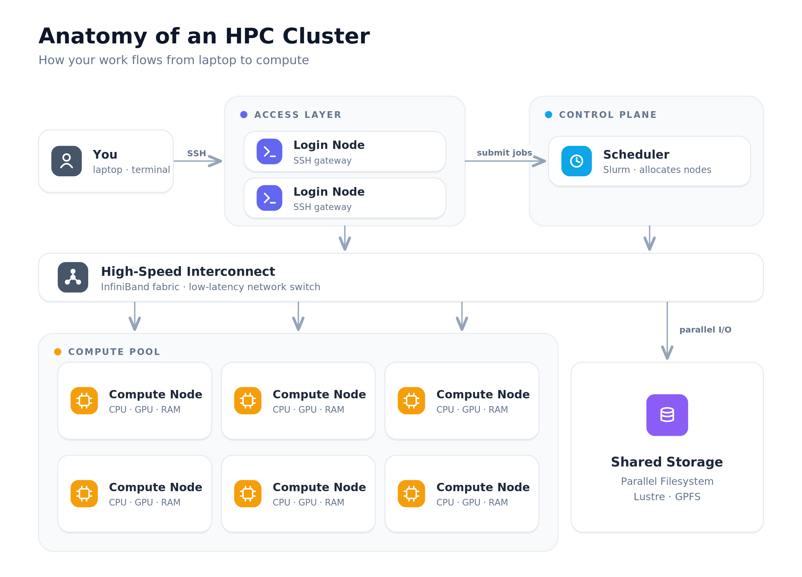
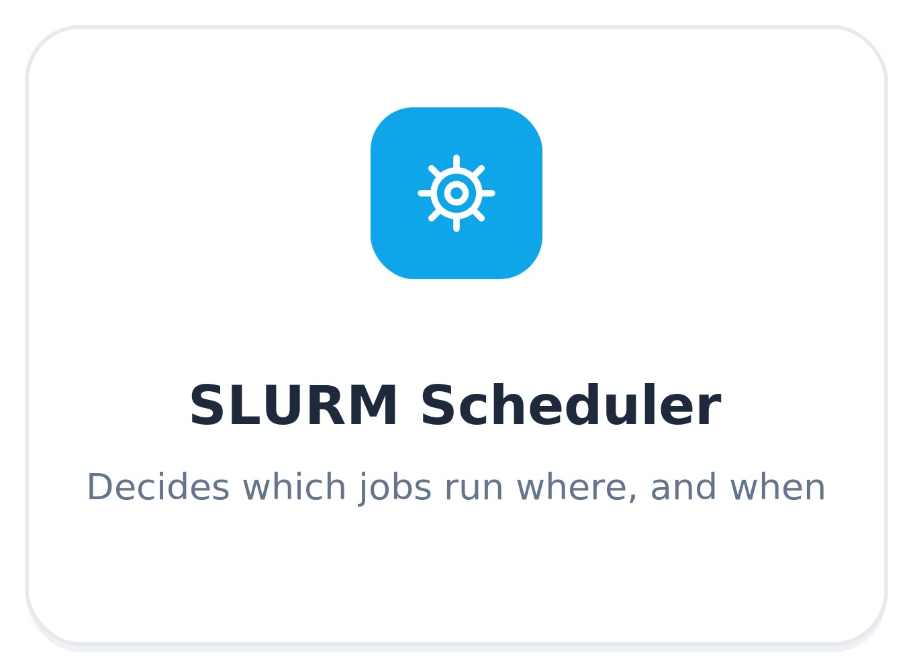
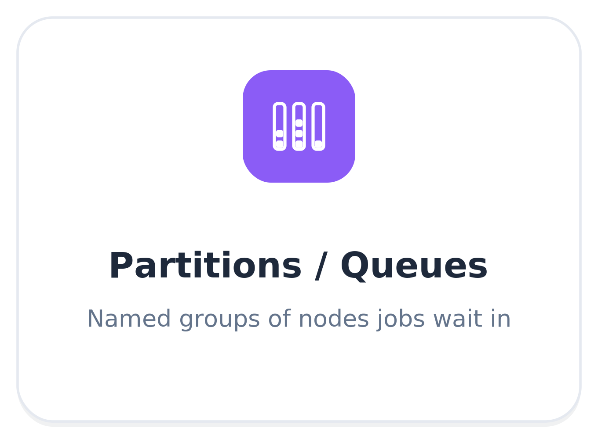
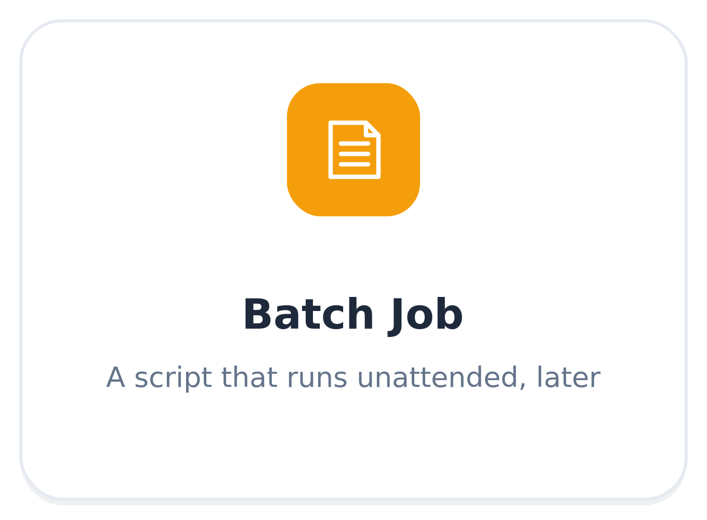
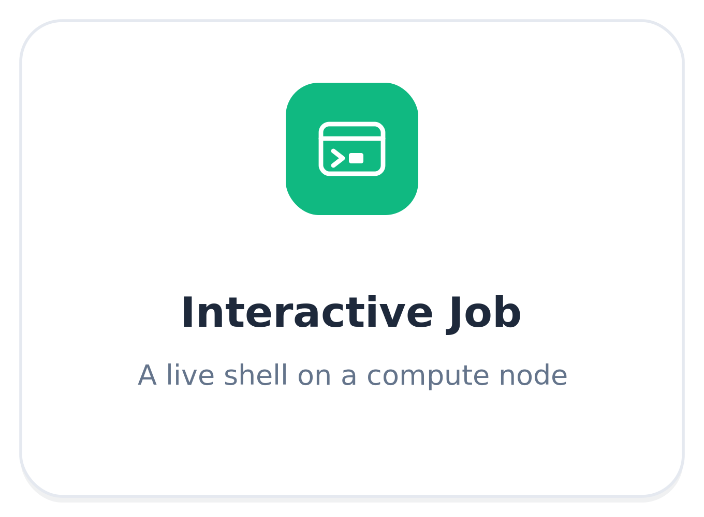

# Lesson 1: Getting Started

## Objectives

**Logging in, submitting your first job, partitions, modules, and setting up your environment**

1. Introduction to HPC clusters
2. Access and logging in:
    - SSH with Duo (RCC): https://docs.rcc.uchicago.edu/connection/ssh/main/
    - SSH (DSI): https://cluster-policy.ds.uchicago.edu/using-the-cluster/login-nodes/ (need to create an SSH key)
3. Cluster Modules and software environments: Create an environment
4. Scheduler, Partitions (or queues), Jobs (interactive and batch): Submitting a job

## 1. What is an HPC cluster?



You can think of an HPC cluster as any number of connected computers. They usually have some common components:

- **Login Nodes** - Serves as primary access for the cluster. These nodes are often limited in resources (e.g., CPU, memory) and exist to allow users to access the cluster and submit computing jobs.
- **Scheduler** - For our purposes this is [SLURM](https://slurm.schedmd.com) (although there are other schedulers out there). The scheduler schedules and executes compute jobs on the cluster. We will learn more about jobs later in this lesson.
- **Compute Nodes** - What the scheduler executes compute jobs on, these are network connected computers with large compute resources - high number of CPUs and memory (RAM). They can also include Graphic Process Units (GPUs) which provide even more compute power via parallelization.
- **Storage** - Shared by the compute nodes, this is where you can store different types of data (e.g., short term vs. long term). We will also cover the different storage options in lesson 3.

> 🧰 - You do not want to execute code on the login nodes as it will slow them down and impact all cluster users.

## 2. UChicago HPC cluster accounts

**RCC:** https://docs.rcc.uchicago.edu/accounts/#general-user-accounts

- Request a general RCC account
- Associate the account with a PI. For access to the Schmidt nodes, use `pi-dfreedman`
- More info: https://chicago-aiscience.github.io/rcc/

**DSI:** https://cluster-policy.ds.uchicago.edu/quickstart/accounts/

- To request an account, email: `techstaff@cs.uchicago.edu`
- Eligibility examples: DSI-related grant, DSI member or affiliated faculty, Student with written approval from a DSI faculty mentor
- More info: https://chicago-aiscience.github.io/dsi/

## 3. Logging into the cluster

**_RCC_**

**Documentation https://docs.rcc.uchicago.edu/connection/main/**

- SSH:
    - Docs: https://docs.rcc.uchicago.edu/connection/ssh/main/
    - Requires DUO be set up to authenticate
    - Access the cluster via terminal
- Open OnDemand:
    - Docs: https://docs.rcc.uchicago.edu/connection/open_ondemand/open_ondemand/
    - Web browser UI access, good for interactive sessions
- VS Code:
    - Docs: https://docs.rcc.uchicago.edu/software/apps-and-envs/scode/main/
    - Provides a VS Code editor interface to the cluster and includes terminal access

**How to SSH into the RCC cluster**

```bash
ssh -Y <CNetID>@midway3.rcc.uchicago.edu
```

**You will then need to enter your CNetID password and select an option to authenticate with Duo:**

```bash
# Enter your password
(<CNetID>@midway3.rcc.uchicago.edu) Password: *

# Select an option to authenticate with Duo
(<CNetID>@midway3.rcc.uchicago.edu) Duo two-factor login for <CNetID>

# Enter a passcode or select one of the following options:

1. Duo Push to XXX-XXX-XXXX
2. Phone call to XXX-XXX-XXXX
3. SMS passcodes to XXX-XXX-XXXX (next code starts with: 2)

#Passcode or option (1-3):
```

> 🧰 - See this [RCC SSH documentation](https://docs.rcc.uchicago.edu/connection/ssh/main/) for SSH authentication details + DUO multifactor authentication

**_DSI_**

**Documentation https://clinic.ds.uchicago.edu/tutorials/ssh_github_cluster.html**

- Follow the link above to learn how to set up SSH for the DSI cluster
- You can also use VS Code's Remote SSH extension to access the cluster but need SSH set up first, here is a link to documentation on the extension: https://code.visualstudio.com/docs/remote/ssh

## 4. Environment modules

On HPC clusters, most scientific software isn’t available in your shell by default.

Instead, packaged tools, languages, libraries, and compilers are managed through Environment Modules which is a system that lets you load, unload, and switch software versions cleanly.

A module is basically a script that sets up your environment (e.g., `PATH`, `LD_LIBRARY_PATH`) so a specific software package and its dependencies become available in your session.

You use the module command (`module avail`, `module load`, etc.) to interact with these.

**The benefit:** no conflicting software versions, easy switching between versions, and reproducibility across compute sessions.

**Modules may also provide:**

- Libraries (e.g., FFTW, MKL) used by other software
- Developer tools (CMake, debugger/profilers)
- Language environments (Perl, Java)

These support both building complex codes and running them smoothly on compute nodes.

**How to run software modules**

1. See what’s available:

```bash
module avail
```

2. Load what you need:

```bash
module load <software>/<version>
```

3. Check what’s loaded:

```bash
module list
```

4. Run `module load <software>/<version>` inside a job script or interactive session.

>🧰 - Loading a module adjusts your environment so the software just works without manual path juggling.

## 5. Creating software environments

For this workshop, we will be working with a `conda` software environment since that is typical for a lot of scientific codebases. We need to create an environment that we can reference when we execute jobs on the cluster.

A software environment can grow quite large in size. This can cause your home directory (or project directory) to quickly run out of space.

**RCC storage:**

- Home: `/home/$USER` (~30 GB)
- Scratch: `/scratch/midways3/$USER` (~100 GB)

**DSI storage:**

- Home: `/home/$USER` (50 GB)
- Scratch: `/scratch` and `/scratch2` (50 GB each)
- Project: `/project` (500 GB default; up to 10 TB)

A good place to store your environment is the `scratch/` directory, but **_keep in mind that the scratch directory is periodically deleted_**.

This script automates the creation of the environment so you don't have to remember a series of commands each time you need to create one: [config/setup_env.sh](https://github.com/chicago-aiscience/workshop-hpc-2026-sep/blob/dev/config/setup_env.sh)

Commands to run the script:

```bash
cd ~/workshop-hpc/workshop-hpc-2026-sep                    # so config/ = the project's config
SCRATCH_BASE=/net/scratch2/$USER bash config/setup_env.sh  # run the script (bash executable)
```

>🧰 - The script will select whichever package manager is available (e.g., conda, mamba, micromamba) but please note the script may take some time to run and install all of the software depedencies defined in [environment.yml](https://github.com/chicago-aiscience/workshop-hpc-2026-sep/blob/dev/environment.yml)

Key command to create environment:

```bash
conda env create -p "/net/scratch2/$USER/workshop-hpc-env" -f "/home/$USER/workshop-hpc-2026-sep/environment.yaml"
```

## 6. Cluster components

### Slurm scheduler



The cluster includes software that manages the execution of algorithms as jobs on the cluster's compute nodes. This software is called a scheduler and is responsible for cluster management and job scheduling.

Both UChicago clusters mentioned here use [SLURM](https://slurm.schedmd.com/overview.html):

- SLURM allocates resources (compute nodes) to users (and jobs) for some duration of time
- It provides a framework for starting, executing and monitoring work on allocated nodes
- It manages a queue of pending work to arbitrate the use of cluster resources between users (and jobs)

### Slurm partitions



SLURM uses partitions to logically group compute nodes, jobs, and allocations of resources.

>The partitions can be considered job queues, each of which has an assortment of constraints such as job size limit, job time limit, users permitted to use it, etc. Priority-ordered jobs are allocated nodes within a partition until the resources (nodes, processors, memory, etc.) within that partition are exhausted.
-[Slurm Workload Manager](https://slurm.schedmd.com/quickstart.html#arch)

You execute algorithms as jobs on a partition. It can be difficult to figure out which parition to use.

For the RCC:

- You can start with the RCC cluster partition description: https://docs.rcc.uchicago.edu/slurm/partitions/
- It may be helpful to start by submitting CPU jobs to the `caslake` partition
- If you have a job that uses GPUs (like the workshop example), you can use the `gpu` partition
- For the RCC cluster there is also the common Schmidt partition: `schmidt-gpu`

For the DSI:

- You can use the `general` parition, and you can request a gpu with `--gres=gpu:1`

### Slurm jobs

A job is how you execute your algorithms on the cluster. There are two types of jobs: batch and interactive

#### batch jobs



You can start the execution of your algorithm by wrapping the code to execute your algorithm in a shell script.

The top of the shell script will include comment-like details that tell Slurm how to execute your job. Here is a simplified example:

```bash
#SBATCH --job-name=gpu_example   # <-- name of the job to execute
#SBATCH --partition=general      # <-- name to partition to execute the job on
#SBATCH --gres=gpu:1             # <-- request 1 GPU (adjust as needed)
#SBATCH --nodes=1                # <-- number of nodes to request to execute on
#SBATCH --ntasks=1               # <-- number of parallel tasks to launch across nodes
#SBATCH --cpus-per-task=4        # <-- number of CPUs to allocate to each task
#SBATCH --mem=32G                # <-- amount of RAM to allocate to the job
#SBATCH --time=02:00:00          # <-- time to execute the job for


CONDA_ENV=/net/scratch2/$USER$/workshop-hpc-env  # <-- software environment created in step  5
activate $CONDA_ENV # <-- activate the environment

module load cuda  # <-- load modules required to execute job

python your_algorithm.py  # <-- Execute your algorithm code
```

Let's say we save this script to a file called `my_job.sh`, then to submit this job you run the following command _on the login node of the cluster_:

```bash
sbatch my_job.sh
```

#### interactive jobs



Sometimes it can be useful to launch a terminal shell on a compute node directly.

**Interactive jobs are ideal for:**

- Debugging jobs that fail in batch mode
- Testing software environments and modules
- Running short experiments or exploratory analyses
- Developing code before scaling up to batch jobs

Basic interactive CPU job:

```bash
srun --partition=general --nodes=1 --ntasks=1 --cpus-per-task=2 --mem=4G --time=01:00:00 --pty bash -i
```

Basic interactive GPU job:

```bash
srun --partition=general --nodes=1 --ntasks=1 --cpus-per-task=2 --mem=4G --time=01:00:00 --pty bash -i
```

> 🧰 - Notice how the arguments to the srun command match the `#SBATCH` comments in the batch script. You can change these to manage the resources allocated to your interactive session.

## 👉 7. Running an interactive job

We are going to turn to the workshop repository to run an interactive job and then later submit a batch job on the RCC cluster.

**Repository link: https://github.com/chicago-aiscience/workshop-hpc-2026-sep**

Before submitting batch jobs, let's get a feel for the cluster and see how we might develop an algorithm to run as a batch script.

### 👉 1. Log into the cluster

```bash
ssh -Y <CNetID>@midway3.rcc.uchicago.edu
```

Enter your `<CNETID>` password and then authenticate with Duo.

### 👉 2. Clone the GitHub repository to the cluster

Note this **requires SSH authentication** be set up between GitHub and the cluster. See [SSH + GitHub](appendix.md#ssh-github)

*Start the SSH agent and load the SSH key you created:*

```bash
eval "$(ssh-agent -s)"
ssh-add ~/.ssh/id_ed25519
```

*Clone the repository:*

```bash
git clone git@github.com:chicago-aiscience/workshop-hpc-2026-sep.git
cd workshop-hpc-2026-sep
```

### 👉 3. Set up the environment (once)

*Run the following command to set up the `conda` environment in your scratch space:*

```bash
SCRATCH_BASE=/scratch/midway3/ntebaldi bash config/setup_env.sh  # run the script (bash executable)
```

**4. Grab an interactive GPU**

```bash
srun --account pi-dfreedman \
     --partition schmidt-gpu \
     --qos=schmidt \
     --nodes=1 \
     --ntasks=1 \
     --cpus-per-task=2 \
     --mem=4GB \
     --gres=gpu:1 \
     --time=01:00:00 \
     --pty bash -i
```

`--pty bash` drops you into a shell *on the compute node*. Confirm the GPU:

```bash
nvidia-smi          # should list one GPU
```

### 👉 4. Copy the data to the cluster

This is a quick preview of the data storage lesson which we will cover in more detail. For now, download the input data needed to run the workshop repository code to your laptop: https://drive.google.com/drive/folders/1kGueYViLp8cWjQhKCXsUP2wbJIt1BrBd?usp=share_link

The data is on the smaller side (~61M) so lets just copy it via `scp`:

```bash
mkdir /scratch/midway3/$USER/workshop-hpc-data/  # create a directory to hold the data

scp -r /path/to/input/directory/on/your/laptop midway:/scratch/midway3/$USER/workshop-hpc-data  # copy the data to the cluster
```

### 👉 5. Define the data paths on the cluster

Modify `config/paths.sh` for the RCC cluster:

```bash
#!/usr/bin/env bash

# Raw inputs: images / masks / json / labels.csv.
export INPUT_DIR=/scratch/midway3/$USER/workshop-hpc-data/input

# Where jobs write manifests, checkpoints, masks, results (scratch, NOT $HOME).
export WORK_DIR=/scratch/midway3/$USER/workshop-hpc-data/output

# Survey labels CSV, derived from INPUT_DIR so it always tracks the data.
export LABELS="$INPUT_DIR/labels.csv"

# Conda/micromamba env (a name, or a full prefix path for a -p env).
export ENV_NAME=/scratch/midway3/$USER/workshop-hpc-env

mkdir -p "$WORK_DIR/data" "$WORK_DIR/runs"
```

### 👉 6. Run the model on one image

```bash
# Load the paths you defined
source config/paths.sh

# Load the python module - can locate with `module avail`
module load python/anaconda-2025.12

# Activate conda environment
conda activate $ENV_NAME

# Build the image/mask pairs manifest
python src/build_manifest.py --input-dir "$INPUT_DIR" --mode train --limit 5 \
    --out "$WORK_DIR/tiny.csv"

# Fine tune the image segmentation model
python src/seg_finetune.py --manifest "$WORK_DIR/tiny.csv" \
    --out "$WORK_DIR"/seg --epochs 1
```

Watch the loss print. When it finishes, `exit` releases the node.

## 👉 8. Running a batch job


We will run all of the steps we walked through above but as a batch job defined by a shell script. See this script: [slurm/02_finetune.sbatch](https://github.com/chicago-aiscience/workshop-hpc-2026-sep/blob/dev/slurm/02_finetune.sbatch)

```bash
#!/usr/bin/env bash
#SBATCH --job-name=seg-finetune
#SBATCH --account=pi-dfreedman          #change to an allowed account on the cluster
#SBATCH --partition=schmidt-gpu         # GPU partition for Schmidt fellows
#SBATCH --qos=schmidt
#SBATCH --gres=gpu:1                    # request 1 GPU (adjust as needed)
#SBATCH --nodes=1
#SBATCH --ntasks=1
#SBATCH --cpus-per-task=8
#SBATCH --mem=32G
#SBATCH --time=02:00:00
#SBATCH --output=logs/finetune_%j.out   # stdout  -> normal log  (Workshop 2)
#SBATCH --error=logs/finetune_%j.err    # stderr  -> error log
# --- Workshop 1: a first batch GPU job. Submit with: sbatch slurm/02_finetune.sbatch

set -euo pipefail
source config/paths.sh

# Load required modules
module load python/anaconda-2025.12

# PyTorch from the conda env bundles its own CUDA runtime, so a system CUDA
# module is usually NOT needed (only the node's NVIDIA driver). Load one if your
# cluster has it, but never let a missing module abort the job.
module load cuda 2>/dev/null || echo "[job] no 'cuda' module; using conda torch's bundled CUDA"
source activate "$ENV_NAME"           # conda env from environment.yml

# 1. Build the training manifest: raw images paired with MANUAL ground-truth
#    masks (1,000-image subset for the workshop).
python src/build_manifest.py --input-dir "$INPUT_DIR" \
    --mode train --limit 1000 \
    --out "$WORK_DIR/data/manifest_train.csv"

# 2. Fine-tune. --resume makes this restartable after preemption (Workshop 2/5).
python src/seg_finetune.py \
    --manifest "$WORK_DIR/data/manifest_train.csv" \
    --out "$WORK_DIR/runs/seg" \
    --epochs 10 --batch-size 4 --resume

echo "finetune complete on $(hostname) job $SLURM_JOB_ID"
```

**To run this script as a batch job:**

```bash
cd $HOME/workshop-hpc-2026-sep
mkdir logs  # create a logs directory for job logs
sbatch workshop-hpc-2026-sep/slurm/02_finetune.sbatch
```

**View job status for running job:**

```bash
squeue -u $USER
```

Example output:

```bash
            JOBID PARTITION     NAME     USER ST       TIME  NODES NODELIST(REASON)
        51473191 schmidt-g seg-fine ntebaldi  R       0:06      1 midway3-0426
```

Review logs:

```bash
cat finetune_51473191.err  # error logs
```

```bash
cat finetune_51473191.out  # standard out logs
```

## ✅ Verification Checkpoint

- You have learned a little bit about clusters and how to execute jobs on them
- You have set up the workshop repository on the RCC cluster via `git clone`
- You have created a software environment that contains the dependencies needed to run the workshop repository code
- You have copied the input data to the cluster
- You have ran an interactive job and executed the first part of the workshop repository code
- You have ran a batch job that executed the first part of the workshop repository code

# Lesson Conclusion

You have run a job!!

Next we will focus on how to monitor jobs and recover from errors.
